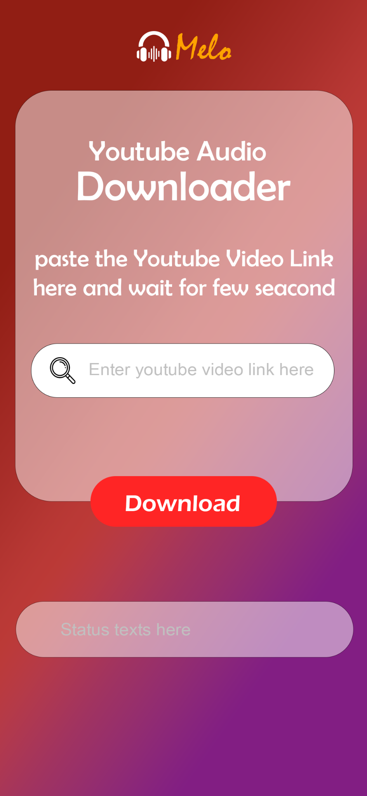

<div align="center">


# Melo

### Your music. Your moments. 🎧

**A simple Android app for downloading audio from YouTube in the highest available quality.**

<br />

<a href="#-download">Download APK</a> ·
<a href="#-how-to-use">How to use</a> ·
<a href="#-screenshots">Screenshots</a> ·
<a href="#-responsible-use">Responsible use</a>

<br /><br />



<br />


</div>

---

## ✨ About Melo

**Melo** is an Android audio-downloader app built around one simple idea: make getting audio from a YouTube video link straightforward.

Paste a video link, start the download, and let Melo handle the audio extraction. It aims to retrieve the **highest available audio quality** offered by the source.

> Made for a clean, focused experience—without a complicated interface.

## 🌟 Highlights

- 🎵 **Audio-first** — focused on downloading audio rather than video files.
- 🔗 **Link-based workflow** — paste a YouTube video URL into the app.
- 🎧 **Highest available quality** — requests the best audio format available from the source.
- 📱 **Android app** — use it from your Android device.
- 🪄 **Simple interface** — a clear input field, download action, and status area.
- 🧡 **Melo identity** — a warm, music-inspired look with a bold red and gradient palette.

*Actual output quality and format can depend on the source and the app's implementation.*

## 📲 Download

### Install the APK

1. Open the **[Releases](../../releases)** page and download the latest `Melo.apk` (if a release is available).
2. On your Android device, open the downloaded APK.
3. If Android asks, allow installation from that source in your device settings.
4. Follow the on-screen instructions to install and open Melo.

**Prefer a direct APK?** If the repository includes an APK in its root, you can link it here by replacing the placeholder below with the exact filename:

`[⬇️ Download Melo APK](./Melo.apk)`

> Android may show a security warning when installing an APK from outside the Play Store. Only install APKs from a source you trust.

## 🚀 How to use

1. **Copy** the URL of the YouTube video you want to process.
2. **Open Melo** on your Android device.
3. **Paste** the video link into the input field.
4. **Tap Download** and wait while the app processes the link.
5. **Check the app's status message** and your device's download location for the result.

## 🖼️ Screenshots

<div align="center">
  
  <p><em>A simple link-in, audio-out workflow.</em></p>
</div>

## 🧭 Project contents

This repository is intended to stay lightweight and may contain only the installable APK, this README, and image assets.

```text
Melo/
├── Melo.apk                 # Android install package (filename may differ)
├── README.md
└── assets/
    ├── melo-logo.png
    └── melo-interface.png
```

The Android source code is **not included** in this repository unless added separately.

## 🛠️ Technical notes

- **App type:** Android application distributed as an APK
- **Primary purpose:** YouTube audio downloading
- **Quality target:** Best available audio stream
- **Repository format:** APK + documentation + visual assets

Implementation details such as the programming language, minimum Android version, permissions, backend, and exact audio format are intentionally not listed here because they can vary by build.

## ⚖️ Responsible use

Please use Melo responsibly.

- Download only content you own, have permission to download, or are otherwise legally allowed to save.
- Respect creators' rights, copyright law, and YouTube's Terms of Service.
- Do not use Melo to redistribute copyrighted audio without authorization.
- This project is provided for personal and educational use; users are responsible for how they use it.

**Melo is an independent project and is not affiliated with, endorsed by, or sponsored by YouTube or Google.** YouTube is a trademark of Google LLC.

## 🐛 Issues & feedback

Found a bug or have an idea to improve Melo? Open an issue in this repository with:

- Your Android version and device model
- What you were trying to do
- The steps to reproduce the issue
- Any error or status message shown by the app

Please **do not** attach private account information or sensitive data.

## 💛 A note from the creator

Melo was made to keep one task simple: turn a video link into an audio download with as little friction as possible.

If you find the project useful, consider starring the repository ⭐

---

<div align="center">

**Melo — let the music stay with you.** 🎶

<sub>Built with care. Use with respect for creators.</sub>

</div>
